# 1. Introducción

La obesidad es un problema de salud pública asociado a enfermedades cardiovasculares, diabetes tipo 2 y
otras condiciones crónicas. Clínicamente se define con el Índice de Masa Corporal,
$IMC = \text{peso}/\text{estatura}^2$, y los cortes de la Organización Mundial de la Salud (OMS). Ese indicador
describe el estado de una persona, pero no explica qué hábitos se asocian a él.

Este trabajo plantea un problema de **clasificación multiclase supervisada**: predecir el nivel de peso u
obesidad de una persona (siete categorías) a partir de sus hábitos alimenticios, su actividad física y datos
demográficos. Se comparan tres modelos de complejidad creciente (regresión logística multinomial, árbol de
decisión y Random Forest), se optimizan sus hiperparámetros y se analiza con detalle su **capacidad de
generalización**, es decir, su rendimiento sobre datos no vistos durante el entrenamiento.

Todos los resultados de este informe provienen de la ejecución real del código del proyecto
(`main.py` y los notebooks), con semilla aleatoria fija (42).

# 2. Planteamiento del problema

Se dispone de una muestra $\{(\mathbf{x}_i, y_i)\}_{i=1}^{n}$, donde $\mathbf{x}_i$ es un vector de
características de la persona $i$ e $y_i \in \{1,\dots,7\}$ es su nivel de obesidad. Se busca una función
$f:\mathcal{X}\to\{1,\dots,7\}$ con el menor **riesgo de generalización**, es decir, con la menor tasa de
error esperada sobre nuevas personas de la misma población.

El dataset presenta una dificultad metodológica central: la etiqueta se construyó a partir del IMC y,
por tanto, a partir de dos de los predictores disponibles (`Weight` y `Height`). Si estos se incluyen, el
modelo puede limitarse a "recalcular" la etiqueta. Parte del trabajo consiste en verificar este problema
y decidir cómo tratarlo (sección 5.4).

# 3. Objetivos

**General.** Entrenar y comparar modelos de clasificación multiclase para el nivel de obesidad y
seleccionar el de mejor capacidad de generalización.

**Específicos.**

1. Describir estadísticamente el dataset e identificar las variables más asociadas con la clase.
2. Evaluar si `Weight` y `Height` producen fuga de información del objetivo.
3. Entrenar regresión logística multinomial, árbol de decisión y Random Forest dentro de *pipelines*
   que eviten la fuga de información en el preprocesamiento.
4. Optimizar los hiperparámetros con Grid Search y Random Search usando validación cruzada estratificada.
5. Reportar accuracy, precision, recall, F1 y matrices de confusión, y comparar el rendimiento en
   entrenamiento, validación cruzada y prueba.
6. Analizar el riesgo empírico frente al riesgo real, el sesgo y la varianza, el sobreajuste y la
   estabilidad, y respaldar la comparación con pruebas estadísticas.

# 4. Descripción del dataset

*Estimation of obesity levels based on eating habits and physical condition* (Palechor y De la Hoz
Manotas, 2019; repositorio UCI). Contiene datos de personas de México, Perú y Colombia de 14 a 61 años.
Según sus autores, el **23 %** de los registros se recolectó con una encuesta web y el **77 %** se generó de
forma sintética con SMOTE (Weka) para balancear las clases.

| Variable | Descripción | Tipo |
|---|---|---|
| Gender | Género | Nominal binaria |
| Age | Edad (años) | Numérica |
| Height / Weight | Estatura (m) / Peso (kg) | Numéricas (antropométricas) |
| family_history_with_overweight | Antecedente familiar de sobrepeso | Nominal binaria |
| FAVC | Consumo frecuente de alimentos hipercalóricos | Nominal binaria |
| FCVC | Frecuencia de consumo de verduras (1–3) | Numérica |
| NCP | Número de comidas principales (1–4) | Numérica |
| CAEC | Consumo de alimentos entre comidas | Ordinal (no < Sometimes < Frequently < Always) |
| SMOKE | Fuma | Nominal binaria |
| CH2O | Consumo diario de agua (1–3) | Numérica |
| SCC | Monitorea las calorías | Nominal binaria |
| FAF | Frecuencia de actividad física (0–3) | Numérica |
| TUE | Tiempo de uso de dispositivos (0–2) | Numérica |
| CALC | Consumo de alcohol | Ordinal |
| MTRANS | Medio de transporte (5 niveles) | Nominal |
| **NObeyesdad** | **Nivel de obesidad (7 clases)** | **Objetivo (ordinal)** |

: Variables del dataset.

**Dimensiones y calidad.** El dataset tiene 2111 filas y 17 columnas, sin valores faltantes, pero con
**24 filas duplicadas** exactas. Los duplicados se eliminaron antes de la partición, porque una copia en
entrenamiento y otra en prueba inflaría la métrica de prueba. Quedaron **2087 observaciones**. La partición
estratificada 80/20 dio **1669 observaciones de entrenamiento y 418 de prueba**.

# 5. Análisis exploratorio

## 5.1 Variable objetivo

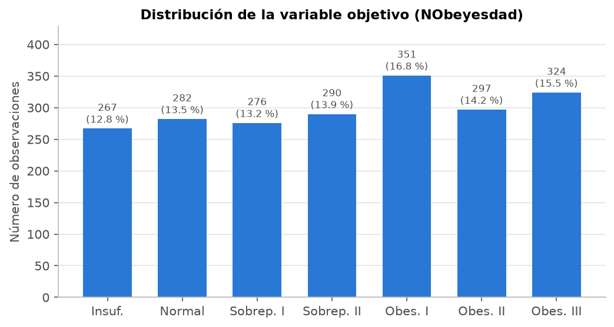{width=80%}

Las siete clases están **aproximadamente balanceadas**: van del 12,8 % (*Insufficient_Weight*, 267 casos)
al 16,8 % (*Obesity_Type_I*, 351 casos). No hace falta corregir el desbalance, pero se usa partición
estratificada y métricas con **promedio macro**, que dan el mismo peso a cada clase.

## 5.2 Variables numéricas y categóricas

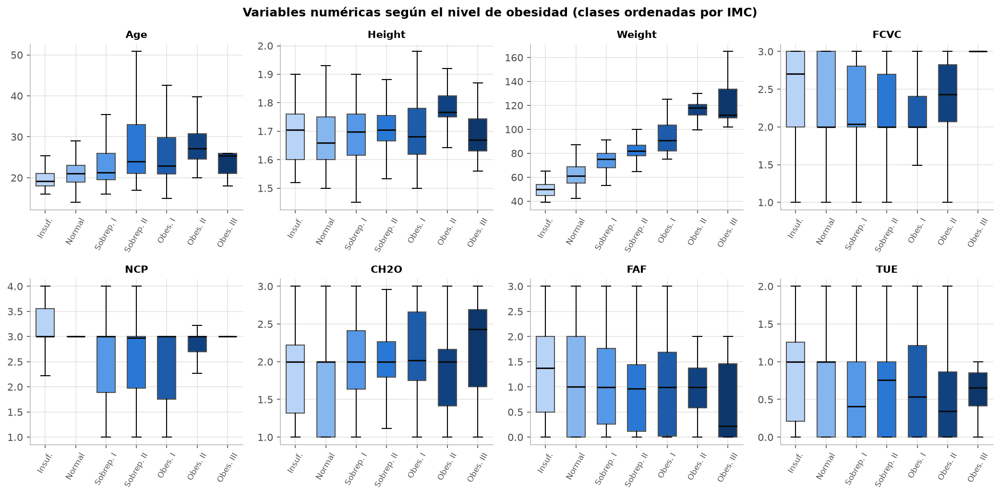

`Weight` crece de forma casi monótona con el nivel de obesidad. `Height` varía poco entre clases. Entre las
variables de hábitos, `Age` y `FCVC` (verduras) son las que más diferencian las clases. Se detectaron
**huellas del origen sintético**: `FCVC`, `NCP`, `CH2O`, `FAF` y `TUE` provienen de preguntas con respuesta
entera, pero entre el 31 % y el 62 % de sus valores no son enteros (resultado de la interpolación de SMOTE).
Se tratan como variables continuas.

Varias categorías son muy poco frecuentes: `CALC = Always` (1 registro), `MTRANS = Bike` (7),
`MTRANS = Motorbike` (11) y `SMOKE = yes` (2 %).

## 5.3 Correlaciones y asociaciones

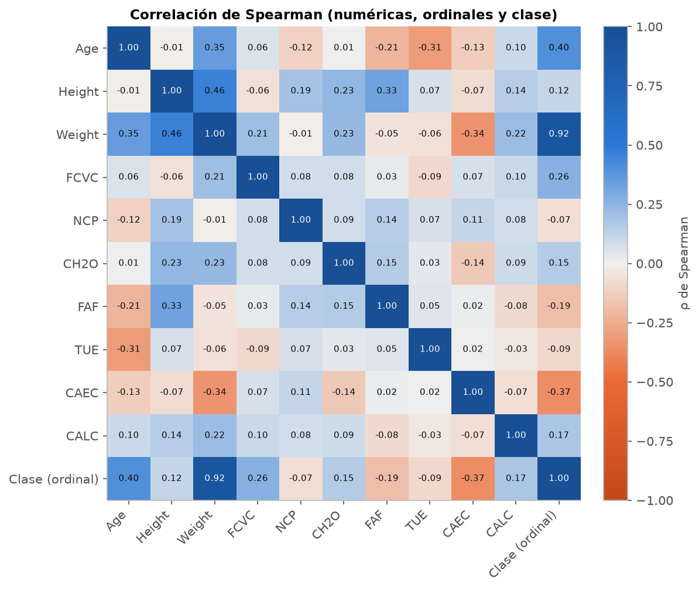{width=72%}

Se usó la correlación de **Spearman**, adecuada para variables ordinales y no normales. Entre los
predictores, todas las correlaciones cumplen $|\rho| \le 0{,}46$ (la mayor es Height–Weight), por lo que no hay
multicolinealidad preocupante. La clase codificada de forma ordinal tiene $\rho = 0{,}92$ con `Weight`,
$0{,}40$ con `Age`, $-0{,}37$ con `CAEC` y $0{,}26$ con `FCVC`.

Para medir la asociación de cada predictor con la clase se usó la **prueba de Kruskal-Wallis** en las
variables numéricas, con tamaño de efecto $\varepsilon^2 = H/(n-1)$, y la **prueba $\chi^2$ de
independencia** en las categóricas, con la **V de Cramér**
$V=\sqrt{\chi^2/(n(\min(r,k)-1))}$. Con $n = 2087$ todas las pruebas resultan significativas
($p < 0{,}001$), así que la comparación relevante es la del tamaño del efecto.

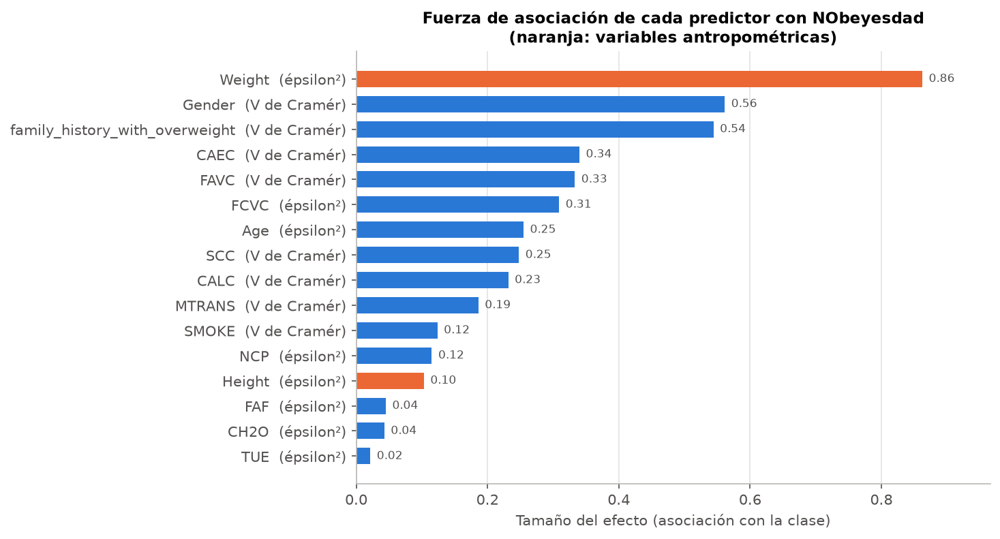{width=80%}

`Weight` domina ($\varepsilon^2 = 0{,}86$). Entre los predictores restantes destacan `Gender` ($V = 0{,}56$),
`family_history_with_overweight` ($0{,}54$), `CAEC` ($0{,}34$), `FAVC` ($0{,}33$) y `FCVC`
($\varepsilon^2 = 0{,}31$). En `CALC` y `MTRANS`, el 25–40 % de las celdas tiene frecuencia esperada
menor que 5, por lo que su p-valor $\chi^2$ es solo aproximado.

**Artefacto relevante:** *Obesity_Type_II* es casi solo masculina (295 de 297) y *Obesity_Type_III* casi
solo femenina (323 de 324). La fuerte asociación de `Gender` se debe al sobremuestreo sintético, no a un
patrón poblacional plausible.

## 5.4 El problema de Weight y Height

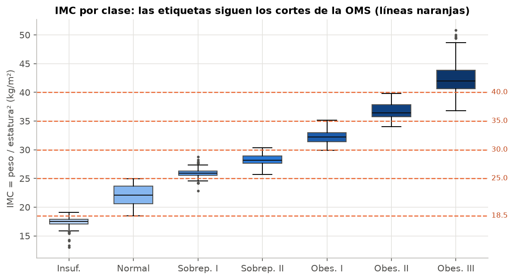{width=80%}

Los rangos de IMC de las clases están ordenados y casi no se solapan. Además, el **95,1 %** de las
etiquetas coincide exactamente con la categoría OMS calculada a partir de peso y estatura (uniendo
Sobrepeso I y II, que la OMS no separa). En el plano peso–estatura, las clases quedan delimitadas por las
curvas $\text{peso} = c\cdot\text{estatura}^2$.

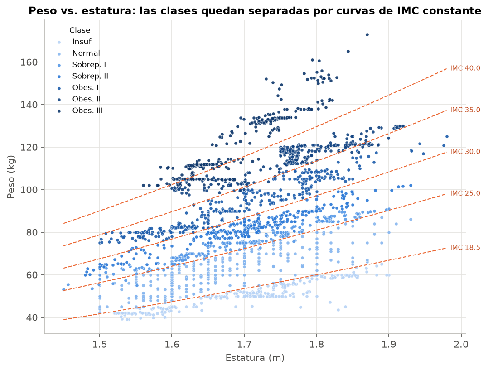{width=65%}

Para medir el efecto sobre los modelos se compararon, con validación cruzada de 5 folds sobre
entrenamiento, los tres modelos por defecto con y sin estas variables, y un árbol que usa **solo el IMC**:

| Escenario | Modelo | F1 macro (CV) |
|---|---|---|
| Sin Weight y Height | Regresión logística | 0,550 ± 0,044 |
| Sin Weight y Height | Árbol de decisión | 0,749 ± 0,034 |
| Sin Weight y Height | Random Forest | 0,846 ± 0,019 |
| Con Weight y Height | Regresión logística | 0,862 ± 0,031 |
| Con Weight y Height | Árbol de decisión | 0,919 ± 0,016 |
| Con Weight y Height | Random Forest | 0,943 ± 0,014 |
| Solo IMC (1 variable) | Árbol (profundidad 4) | **0,954 ± 0,013** |

: Efecto de incluir las variables antropométricas (media ± desviación en 5 folds).

Una sola variable derivada de peso y estatura supera a cualquier modelo con las 16 variables. Esto
confirma una **fuga de información del objetivo** (*target leakage*; Kaufman et al., 2012): la definición
de la etiqueta forma parte de los predictores. Con `Weight` y `Height`, el modelo aprende la fórmula del
IMC y no la relación entre hábitos y obesidad. La métrica alta resultante no mide una capacidad de
generalización útil, porque quien conoce peso y estatura no necesita un modelo.

**Decisión:** el escenario principal **excluye `Weight` y `Height`** y usa 14 predictores de hábitos y
datos demográficos. El rendimiento será menor, pero responde a una pregunta con sentido estadístico y
práctico: ¿qué tan bien predicen los hábitos el nivel de obesidad?

# 6. Metodología

1. **Limpieza:** eliminación de 24 duplicados.
2. **Partición:** `train_test_split` estratificado, 80 % entrenamiento y 20 % prueba, semilla 42. El
   conjunto de prueba solo se usa en la evaluación final y no interviene en ninguna selección.
3. **Pipelines:** preprocesamiento y modelo encapsulados en un `Pipeline` de scikit-learn. En cada fold, el
   escalador y los codificadores se ajustan solo con la parte de entrenamiento de ese fold.
4. **Línea base:** los tres modelos con hiperparámetros por defecto, evaluados con validación cruzada.
5. **Optimización:** Grid Search y Random Search con **validación cruzada estratificada de 5 folds**
   (`StratifiedKFold`, *shuffle*, semilla 42). La métrica guía es el **F1 macro**. Para cada modelo se
   elige la búsqueda con mayor F1 medio en validación.
6. **Evaluación:** métricas en entrenamiento, validación cruzada y prueba, más matrices de confusión.
7. **Generalización:** riesgo empírico frente a riesgo de prueba, curvas de aprendizaje, curvas de
   validación, validación cruzada repetida 5×5, *t*-test corregido de Nadeau-Bengio, prueba de McNemar e
   intervalos de confianza bootstrap.

**¿Por qué F1 macro?** Es la media no ponderada del F1 de cada clase. Penaliza un modelo que funcione bien
en unas clases y mal en otras. Con clases casi balanceadas es coherente con la accuracy, pero es más
informativo sobre los errores por clase.

# 7. Fundamentos teóricos de los modelos

## 7.1 Regresión logística multinomial

**Modelo.** Para $K$ clases, la regresión logística multinomial (*softmax*) asigna a cada clase una función
lineal $z_k = \mathbf{w}_k^\top\mathbf{x} + b_k$ y la convierte en probabilidad:

$$P(y=k\mid\mathbf{x}) = \frac{\exp(\mathbf{w}_k^\top\mathbf{x}+b_k)}{\sum_{j=1}^{K}\exp(\mathbf{w}_j^\top\mathbf{x}+b_j)}.$$

La predicción es la clase de mayor probabilidad. El log-odds entre dos clases es lineal en $\mathbf{x}$, de
modo que **las fronteras de decisión son hiperplanos**. A diferencia del esquema uno-contra-todos, se estima
un único modelo conjunto cuyas probabilidades suman 1.

**Estimación.** Se minimiza la entropía cruzada (equivalente a maximizar la verosimilitud) con un término de
regularización. En la parametrización de scikit-learn:

$$\min_{W,\mathbf{b}}\; C\sum_{i=1}^{n}-\log P(y_i\mid\mathbf{x}_i) + \frac{1-\rho}{2}\lVert W\rVert_2^2 + \rho\lVert W\rVert_1 ,$$

donde $C$ es el **inverso** de la fuerza de regularización y $\rho$ (`l1_ratio`) define su tipo:
$\rho=0$ es L2 (Ridge, encoge los coeficientes), $\rho=1$ es L1 (Lasso, puede anular coeficientes y
seleccionar variables) y $0<\rho<1$ es Elastic Net. El problema es convexo y se resuelve numéricamente:
`lbfgs` (método cuasi-Newton) solo admite L2 y `saga` (gradiente estocástico con reducción de varianza)
admite los tres tipos.

**Características y limitaciones.** Es interpretable (cada coeficiente es un cambio en log-odds), entrega
probabilidades y tiene baja varianza. Su principal limitación es el **sesgo**: no captura interacciones ni
relaciones no lineales si no se crean manualmente. Además, requiere variables estandarizadas para que la
penalización trate a todos los coeficientes por igual.

## 7.2 Árbol de decisión

**Funcionamiento.** El árbol (CART; Breiman et al., 1984) divide recursivamente el espacio de las variables
en regiones rectangulares mediante preguntas del tipo $x_j \le t$. Cada hoja predice la clase mayoritaria de
sus observaciones.

**Criterios de división.** En un nodo con proporciones de clase $p_k$, la impureza se mide con:

$$\text{Gini}=1-\sum_{k=1}^{K}p_k^2, \qquad \text{Entropía}=-\sum_{k=1}^{K}p_k\log_2 p_k .$$

Ambas valen 0 en un nodo puro y son máximas cuando las clases están mezcladas. El algoritmo elige, de forma
voraz, la variable y el umbral que maximizan la reducción de impureza:

$$\Delta I = I(\text{padre}) - \frac{n_L}{n}I(L) - \frac{n_R}{n}I(R).$$

**Profundidad y sobreajuste.** Sin restricciones, el árbol crece hasta que cada hoja es pura y alcanza error
de entrenamiento cero. Así, ajusta también el ruido de la muestra: tiene **sesgo bajo y varianza alta**, y
pequeños cambios en los datos producen árboles muy distintos. `max_depth`, `min_samples_split` y
`min_samples_leaf` limitan su crecimiento (pre-poda) y reducen la varianza a cambio de más sesgo. La
complejidad del árbol (número de hojas) determina su capacidad.

**Ventajas.** Es interpretable, captura interacciones y no linealidades, y no necesita escalado porque es
invariante a transformaciones monótonas de las variables.

## 7.3 Random Forest

**Ensamble por *bagging*.** Random Forest (Breiman, 2001) entrena $B$ árboles profundos, cada uno sobre una
**muestra bootstrap** de los datos (muestreo con reemplazo). En cada división, solo considera un
**subconjunto aleatorio de $m$ variables** (`max_features`). La predicción combina los árboles por promedio
de probabilidades, que equivale aproximadamente a un voto mayoritario:

$$\hat f(\mathbf{x}) = \arg\max_k \frac{1}{B}\sum_{b=1}^{B}\hat p_b(k\mid\mathbf{x}).$$

**Por qué mejora a un árbol individual.** Si cada árbol tiene varianza $\sigma^2$ y la correlación entre
árboles es $\rho$, la varianza del promedio es

$$\rho\,\sigma^2+\frac{1-\rho}{B}\,\sigma^2 .$$

El *bootstrap* y la selección aleatoria de variables **reducen $\rho$**, y promediar muchos árboles hace
pequeño el segundo término. El ensamble conserva el bajo sesgo de los árboles profundos y **reduce mucho
su varianza**. El costo es menor interpretabilidad y mayor costo computacional.

**Hiperparámetros principales.** `n_estimators` ($B$, número de árboles: más árboles estabilizan el
promedio y no producen sobreajuste, pero cuestan más tiempo), `max_features` ($m$: valores menores
decorrelacionan más los árboles), `max_depth`, `min_samples_split` y `min_samples_leaf` (complejidad de
cada árbol).

# 8. Preprocesamiento

El preprocesamiento se implementó con un `ColumnTransformer` dentro del `Pipeline`:

| Grupo | Variables | Transformación |
|---|---|---|
| Numéricas | Age, FCVC, NCP, CH2O, FAF, TUE | Estandarización $z=(x-\bar x)/s$ (solo en regresión logística) |
| Ordinales | CAEC, CALC | Codificación 0 < 1 < 2 < 3 según su orden (+ estandarización en regresión logística) |
| Nominales | Gender, family_history, FAVC, SMOKE, SCC, MTRANS | One-Hot (una sola columna 0/1 para las binarias) |

: Preprocesamiento por tipo de variable.

**Justificación.** La codificación ordinal conserva la información de orden de `CAEC` y `CALC` con una sola
columna. One-Hot evita imponer un orden artificial a las nominales. Se estandariza solo para la regresión
logística, porque su penalización depende de la escala de los coeficientes. Los árboles no la necesitan.
`handle_unknown="ignore"` codifica como ceros una categoría rara que no aparezca en un fold de
entrenamiento (por ejemplo, `MTRANS = Bike`). El resultado son **18 columnas** de entrada.

Como todo el preprocesamiento ocurre dentro del `Pipeline`, las medias, desviaciones y categorías se
estiman solo con los datos de entrenamiento de cada fold. Así se evita la fuga de información hacia la
validación y la prueba.

# 9. Optimización de hiperparámetros

**Grid Search** evalúa todas las combinaciones de una rejilla. **Random Search** (Bergstra y Bengio, 2012)
evalúa $n$ combinaciones muestreadas de distribuciones. Es más eficiente cuando pocos hiperparámetros
importan, porque explora más valores distintos de cada uno.

| Modelo | Hiperparámetro | Grid | Random |
|---|---|---|---|
| Reg. logística | `C` | {0,01; 0,1; 1; 10; 100} | log-uniforme $[10^{-3},10^{3}]$ |
| | regularización (`l1_ratio`) | lbfgs: L2; saga: L2, EN, L1 | saga: {0; 0,5; 1} |
| Árbol | `criterion` | gini, entropy | gini, entropy |
| | `max_depth` | {3, 5, 8, 12, None} | {None, 2…25} |
| | `min_samples_split` | {2, 10, 20} | uniforme entera [2, 40] |
| | `min_samples_leaf` | {1, 5, 10} | uniforme entera [1, 20] |
| Random Forest | `n_estimators` | {100, 300} | [50, 500] |
| | `max_depth` | {10, 20, None} | {None, 5…30} |
| | `min_samples_split` | {2, 5} | [2, 20] |
| | `min_samples_leaf` | {1, 2} | [1, 10] |
| | `max_features` | {sqrt, log2} | {sqrt, log2, 0,5} |

: Espacios de búsqueda. Random Search: 20 (RL), 40 (árbol) y 30 (RF) combinaciones.

**Significado de cada hiperparámetro.** `C` controla la regularización: un valor bajo produce un modelo más
simple y más sesgado. `l1_ratio` elige el tipo de penalización y `solver` el algoritmo de optimización.
`max_depth` limita la profundidad: un valor mayor da más complejidad y más varianza. `min_samples_split` y
`min_samples_leaf` exigen un mínimo de observaciones para dividir un nodo o formar una hoja: valores
mayores producen fronteras más suaves. `criterion` define la medida de impureza. En Random Forest,
`n_estimators` es el número de árboles y `max_features` el número de variables candidatas en cada división.

| Modelo | Método | Comb. | F1 entren. (CV) | F1 validación (CV) | Mejores hiperparámetros |
|---|---|---|---|---|---|
| Reg. logística | Por defecto | 1 | 0,573 | 0,550 ± 0,044 | C = 1, L2, lbfgs |
| | Grid | 20 | 0,578 | 0,555 ± 0,041 | C = 100, L2, lbfgs |
| | **Random** | 20 | 0,578 | **0,555 ± 0,042** | C = 793,2, L2, saga |
| Árbol | Por defecto | 1 | 1,000 | 0,749 ± 0,034 | sin restricciones |
| | **Grid** | 90 | 1,000 | **0,749 ± 0,034** | gini, max_depth = None, split = 2, leaf = 1 |
| | Random | 40 | 0,832 | 0,702 ± 0,036 | gini, max_depth = 9, split = 9, leaf = 1 |
| Random Forest | Por defecto | 1 | 1,000 | 0,846 ± 0,019 | 100 árboles, sin restricciones |
| | **Grid** | 48 | 0,992 | **0,854 ± 0,015** | 300 árboles, max_depth = 20, split = 5, leaf = 1, sqrt |
| | Random | 30 | 0,970 | 0,839 ± 0,012 | 58 árboles, max_depth = 18, split = 8, leaf = 1, sqrt |

: Resultados de la búsqueda (CV estratificada de 5 folds sobre entrenamiento; en negrita, la configuración seleccionada).

**Interpretación.**

- **Regresión logística:** las dos búsquedas llegan al mismo punto, una regularización L2 muy débil (C grande).
  La diferencia entre Grid (0,5551) y Random (0,5552) es despreciable. La mejora respecto al modelo por
  defecto es mínima porque el límite del modelo es su **linealidad**, no la regularización.
- **Árbol:** la rejilla selecciona el árbol sin restricciones, que coincide con el modelo por defecto. La
  segunda mejor combinación (profundidad 12) obtiene un F1 de validación casi igual (0,747), con menor
  desviación (0,022 frente a 0,034) y menos ajuste en entrenamiento (0,969). Random Search eligió un árbol
  más podado con peor validación. En este dataset, restringir el árbol no mejora la validación.
- **Random Forest:** Grid Search mejora levemente al modelo por defecto (+0,008) y reduce algo el ajuste en
  entrenamiento. Con 18 columnas codificadas, `sqrt` y `log2` dan el mismo valor ($m=4$), por eso empatan.
- Random Search no superó a Grid Search en los modelos de árboles. Las rejillas eran pequeñas y ya
  cubrían la región óptima. Con 30–40 muestras de un espacio más amplio, Random Search no llegó a ella.

# 10. Evaluación y comparación

| Modelo | Acc. entren. | Acc. prueba | Precision (prueba) | Recall (prueba) | F1 entren. | F1 CV | F1 prueba | Brecha F1 entren.–prueba |
|---|---|---|---|---|---|---|---|---|
| Reg. logística | 0,602 | 0,586 | 0,575 | 0,572 | 0,578 | 0,555 | 0,549 | 0,030 |
| Árbol de decisión | 1,000 | 0,730 | 0,725 | 0,729 | 1,000 | 0,749 | 0,724 | 0,276 |
| **Random Forest** | 0,991 | **0,857** | **0,858** | **0,853** | 0,991 | **0,854** | **0,852** | 0,139 |

: Comparación de los modelos optimizados (precision, recall y F1 con promedio macro).

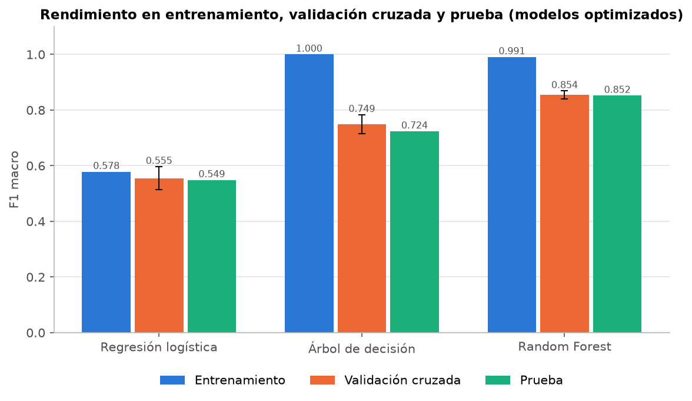{width=75%}

| Modelo | Versión | F1 entren. | F1 CV | F1 prueba | Accuracy prueba |
|---|---|---|---|---|---|
| Reg. logística | Por defecto | 0,572 | 0,550 | 0,542 | 0,584 |
| | Optimizado | 0,578 | 0,555 | 0,549 | 0,586 |
| Árbol | Por defecto | 1,000 | 0,749 | 0,724 | 0,730 |
| | Optimizado | 1,000 | 0,749 | 0,724 | 0,730 |
| Random Forest | Por defecto | 1,000 | 0,846 | 0,845 | 0,849 |
| | Optimizado | 0,991 | 0,854 | 0,852 | 0,857 |

: Antes y después de la optimización.

La optimización aportó mejoras pequeñas (≤ 0,008 en F1). Los valores por defecto de scikit-learn ya
eran razonables para este problema. La mejora en prueba acompaña a la de validación cruzada, lo que indica
que la búsqueda no sobreajustó la validación.

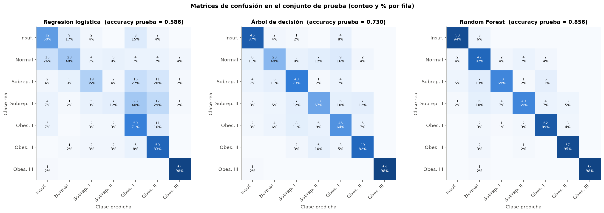

| Clase | F1 RL | F1 Árbol | F1 RF |
|---|---|---|---|
| Insufficient_Weight | 0,571 | 0,807 | 0,917 |
| Normal_Weight | 0,479 | 0,560 | 0,752 |
| Overweight_Level_I | 0,427 | 0,678 | 0,760 |
| Overweight_Level_II | 0,184 | 0,595 | 0,755 |
| Obesity_Type_I | 0,571 | 0,638 | 0,861 |
| Obesity_Type_II | 0,645 | 0,797 | 0,927 |
| Obesity_Type_III | 0,962 | 0,992 | 0,992 |

: F1 por clase en el conjunto de prueba.

Los tres modelos clasifican casi perfectamente *Obesity_Type_III* (en buena parte por el artefacto de
género). La regresión logística casi no reconoce *Overweight_Level_II* (recall 0,12) y la confunde con
*Obesity_Type_I/II*. En los tres modelos, los errores se concentran en **clases vecinas** del eje ordinal
(Normal, Sobrepeso I y Sobrepeso II), cuyos perfiles de hábitos son similares. Este error es menos grave
que confundir clases extremas, que casi no ocurre en el Random Forest.

# 11. Análisis de generalización y sobreajuste

## 11.1 Riesgo empírico y riesgo real

Dada una función de pérdida $L$, el **riesgo real** o de generalización es el error esperado sobre la
distribución de los datos, y el **riesgo empírico** es su promedio sobre la muestra de entrenamiento:

$$R(f)=\mathbb{E}_{(X,Y)\sim P}\big[L(Y,f(X))\big],\qquad \hat R_n(f)=\frac{1}{n}\sum_{i=1}^{n}L(y_i,f(\mathbf{x}_i)).$$

Con la pérdida 0-1, $L(y,\hat y)=\mathbb{1}[y\neq\hat y]$, el riesgo es la tasa de error. $R(f)$ no se
puede calcular porque $P$ es desconocida. Si $f$ se elige minimizando $\hat R_n$, entonces $\hat R_n(f)$ es
una estimación **optimista** de $R(f)$, ya que el modelo se ajustó a esa misma muestra. La diferencia
$R(f)-\hat R_n(f)$ es la **brecha de generalización**. La teoría del aprendizaje estadístico (Vapnik, 1998)
acota esta brecha con un término que crece con la **capacidad** de la clase de modelos y decrece con $n$.
Para una clase finita $\mathcal F$, con probabilidad $1-\delta$:

$$R(f)\le \hat R_n(f)+\sqrt{\frac{\ln|\mathcal F|+\ln(1/\delta)}{2n}}.$$

El error en un conjunto de prueba independiente es un estimador **insesgado** de $R(f)$, con error estándar
$\sqrt{R(1-R)/n_{\text{test}}}$. La validación cruzada aproxima $R$ usando solo los datos de entrenamiento.

| Modelo | Riesgo empírico $\hat R_n$ | Riesgo CV | Riesgo prueba (± EE) | Brecha (prueba − empírico) |
|---|---|---|---|---|
| Reg. logística | 0,398 | 0,421 | 0,414 ± 0,024 | 0,016 |
| Árbol de decisión | 0,000 | 0,244 | 0,270 ± 0,022 | 0,270 |
| **Random Forest** | 0,009 | 0,143 | **0,144 ± 0,017** | 0,135 |

: Riesgos con pérdida 0-1 (tasa de error).

**Lectura.** El árbol tiene el menor riesgo empírico (0), pero un riesgo real alto. Su riesgo empírico no
informa nada sobre su desempeño futuro. La regresión logística tiene la menor brecha, pero el mayor riesgo
real. El Random Forest tiene el **menor riesgo real**, y su estimación por CV (0,143) coincide con la de
prueba (0,144). **Ni el mejor resultado de entrenamiento ni la menor brecha identifican al mejor modelo**:
el criterio correcto es el riesgo de generalización estimado.

## 11.2 Sesgo, varianza, sobreajuste y subajuste

Para la pérdida cuadrática, el error esperado se descompone como

$$\mathbb{E}\big[(Y-\hat f(\mathbf{x}))^2\big]=\underbrace{\big(\mathbb{E}[\hat f(\mathbf{x})]-f(\mathbf{x})\big)^2}_{\text{sesgo}^2}+\underbrace{\mathrm{Var}\big[\hat f(\mathbf{x})\big]}_{\text{varianza}}+\underbrace{\sigma^2}_{\text{ruido irreducible}} .$$

Para clasificación no hay una descomposición aditiva tan simple, pero la interpretación es la misma. Un
modelo con **sesgo alto** es demasiado rígido y falla tanto en entrenamiento como en prueba (**subajuste**).
Un modelo con **varianza alta** se adapta a las particularidades de la muestra: acierta en entrenamiento y
falla en prueba (**sobreajuste**). Aumentar la complejidad reduce el sesgo y aumenta la varianza.

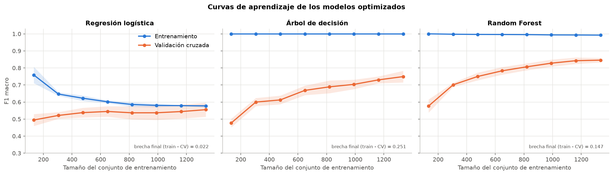

- **Regresión logística: subajuste (sesgo alto).** Las curvas de entrenamiento y validación convergen
  pronto hacia $\approx 0{,}56$ y quedan separadas por solo 0,022. Más datos no la mejorarían, porque una
  frontera lineal no representa bien el problema.
- **Árbol de decisión: sobreajuste (varianza alta).** El F1 de entrenamiento es 1,0 con cualquier tamaño de
  muestra. La curva de validación sube despacio y termina 0,25 por debajo.
- **Random Forest: equilibrio.** También interpola el entrenamiento, pero su curva de validación crece de
  forma sostenida, de 0,58 a 0,85, y la brecha final (0,147) es menor. La curva no se ha estabilizado del
  todo, así que más datos probablemente lo mejorarían algo.

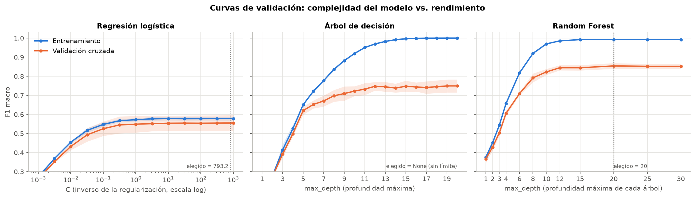

Las curvas de validación muestran la relación entre **complejidad y generalización**. En la regresión
logística, una regularización fuerte (C < 0,1) produce subajuste, y desde C ≈ 1 la validación es plana: el
modelo ya alcanzó su capacidad. En el árbol, con profundidad 1–5 ambas curvas suben juntas (se reduce el
sesgo). Desde profundidad 12, el entrenamiento sigue subiendo hasta 1,0 y la validación se estanca en
≈ 0,74–0,75: la complejidad adicional solo aumenta la varianza. En el Random Forest la validación también
se estabiliza desde profundidad 12–20, pero en un nivel mucho más alto (≈ 0,85). El promedio de muchos
árboles **neutraliza la varianza** que tendría cada árbol profundo por separado.

**Sobre la brecha del Random Forest (0,14).** Una brecha entrenamiento–prueba grande no implica, por sí
sola, una mala generalización. Los árboles del bosque son profundos y casi memorizan la muestra, por lo
que el error de entrenamiento no es informativo. Lo relevante es que la estimación de validación y la de
prueba coinciden y son las mejores de los tres modelos.

## 11.3 Estabilidad

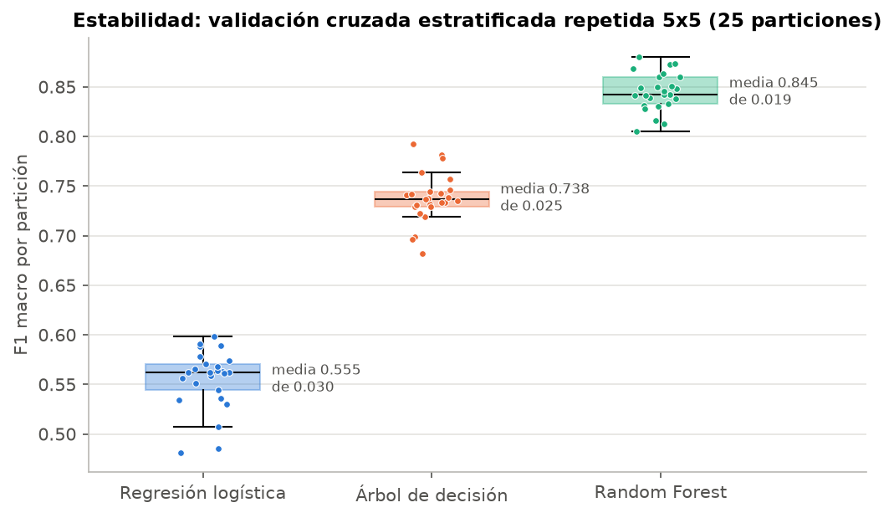{width=72%}

| Modelo | Media F1 | Desv. estándar | Mín. | Máx. | Coef. de variación |
|---|---|---|---|---|---|
| Reg. logística | 0,555 | 0,030 | 0,481 | 0,598 | 5,4 % |
| Árbol de decisión | 0,738 | 0,025 | 0,682 | 0,792 | 3,4 % |
| **Random Forest** | **0,845** | **0,019** | 0,805 | 0,880 | **2,2 %** |

: Estabilidad en validación cruzada repetida 5×5.

El Random Forest es el más estable: su peor partición (0,805) supera a la mejor del árbol (0,792).

## 11.4 Pruebas estadísticas

- ***t*-test pareado corregido (Nadeau y Bengio, 2003)** sobre las 25 particiones. El *t*-test clásico
  subestima la varianza porque los folds comparten observaciones. La corrección usa
  $t=\bar d\big/\sqrt{(1/J+n_{\text{val}}/n_{\text{train}})\,s_d^2}$, con $J=25$. Resultados: RF vs.
  árbol, $\bar d=0{,}107$, $t=8{,}50$, $p<0{,}001$. RF vs. RL, $\bar d=0{,}290$, $t=21{,}6$, $p<0{,}001$.
  Árbol vs. RL, $\bar d=0{,}183$, $t=9{,}68$, $p<0{,}001$.
- **Prueba de McNemar (exacta)** sobre el conjunto de prueba. Compara los casos en que solo uno de los dos
  modelos acierta. El RF acierta 70 casos que el árbol falla, frente a 17 en sentido contrario. Frente a la
  RL, la proporción es de 121 a 8. Ambas diferencias tienen $p<0{,}001$.
- **Intervalos de confianza bootstrap del 95 %** (2000 remuestreos del conjunto de prueba) para el F1 macro:
  RF [0,814; 0,884], árbol [0,682; 0,764], RL [0,502; 0,592]. Los intervalos no se solapan.

Las tres pruebas coinciden: el orden **Random Forest > Árbol > Regresión logística** es estadísticamente
significativo.

# 12. Discusión de resultados

1. **El tratamiento de Weight y Height es la decisión más importante del proyecto.** Con estas variables,
   cualquier modelo supera F1 = 0,86, y una regla basada en el IMC llega a 0,95. Ese rendimiento mide la
   capacidad de recalcular una fórmula, no de generalizar desde los hábitos. Sin ellas, el mejor modelo
   alcanza F1 = 0,85 con información de hábitos y datos demográficos.
2. **La relación entre hábitos y obesidad no es lineal.** La regresión logística se queda en 0,55 incluso
   sin regularización. Los modelos basados en árboles capturan interacciones (por ejemplo, edad × antecedente
   familiar × consumo de verduras) que la frontera lineal no representa.
3. **El ensamble resuelve el problema de varianza del árbol.** El árbol y el bosque tienen un sesgo similar,
   porque ambos interpolan el entrenamiento, pero el bosque reduce la varianza al promediar árboles
   decorrelacionados. Esto se refleja en +0,13 de F1 en prueba y en menor dispersión entre particiones.
4. **Validación cruzada y prueba coinciden.** Las diferencias entre F1 de CV y de prueba fueron de 0,007
   (RL), 0,025 (árbol) y 0,002 (RF). Esto respalda que la selección hecha solo con CV fue fiable y que la
   prueba no se usó indebidamente.
5. **Variables influyentes.** Según la importancia por permutación en prueba
   (figura `16_importancia_permutacion.png`), el Random Forest depende sobre todo de `Gender`, `Age`,
   `FCVC` y `family_history_with_overweight`, seguidas de `NCP`. `SMOKE` no aporta información.
6. **Limitaciones.** (i) El 77 % de los datos es sintético. Esto produce artefactos (género casi
   determinista en Obesidad II y III, respuestas de encuesta no enteras) que pueden inflar el rendimiento y
   limitar la validez externa: el modelo debería validarse con datos reales recolectados de forma
   independiente. (ii) La etiqueta es ordinal, pero los modelos la tratan como nominal, de modo que confundir
   clases lejanas pesa igual que confundir clases vecinas. (iii) Los hábitos son autorreportados.

# 13. Selección del mejor modelo

**Modelo seleccionado: Random Forest** (Grid Search: `n_estimators = 300`, `max_depth = 20`,
`min_samples_split = 5`, `min_samples_leaf = 1`, `max_features = "sqrt"`), guardado en
`models/random_forest.joblib`.

| Criterio | Reg. logística | Árbol | Random Forest |
|---|---|---|---|
| Rendimiento predictivo (F1 prueba) | 0,549 | 0,724 | **0,852** |
| Generalización (riesgo real estimado) | 0,414 | 0,270 | **0,144** |
| Brecha entrenamiento–prueba (F1) | **0,030** | 0,276 | 0,139 |
| Complejidad | **Baja** (~133 coeficientes) | Media (1 árbol profundo) | Alta (300 árboles) |
| Estabilidad (desv. CV 5×5) | 0,030 | 0,025 | **0,019** |

: Criterios de selección.

**Justificación.** El Random Forest tiene el menor riesgo de generalización estimado tanto por CV como en
prueba, con estimaciones casi idénticas, la mayor estabilidad y diferencias estadísticamente
significativas frente a los otros dos modelos. Su brecha entrenamiento–prueba es mayor que la de la
regresión logística, pero esa brecha pequeña se debe al subajuste: la logística falla igual en
entrenamiento que en prueba. Frente al árbol individual, el bosque reduce a la mitad la brecha y el riesgo
real.

**Ventajas frente a los otros modelos:** mayor exactitud en todas las clases, robustez frente a la varianza
y capacidad de modelar interacciones sin crear variables manualmente.
**Limitaciones:** menor interpretabilidad que la regresión logística o un árbol (se compensa en parte con la
importancia por permutación), mayor costo computacional y un modelo pesado en memoria. Si la
interpretabilidad fuera prioritaria, el árbol de profundidad 12 sería una alternativa: tiene un F1 de
validación casi igual al del árbol completo (0,747) y es más simple, pero rinde unos 0,10 menos que el
bosque.

# 14. Conclusiones

1. Se construyó un flujo reproducible de clasificación multiclase (limpieza, partición estratificada,
   *pipelines* sin fuga de información, optimización con validación cruzada y evaluación en un conjunto de
   prueba independiente).
2. `Weight` y `Height` definen la variable objetivo a través del IMC (95,1 % de coincidencia con la regla de
   la OMS). Incluirlas produce fuga de información del objetivo, por lo que se excluyeron del escenario
   principal.
3. Sin variables antropométricas, el **Random Forest** alcanzó en prueba **accuracy = 0,857** y
   **F1 macro = 0,852** (IC 95 %: 0,814–0,884), frente a 0,724 del árbol y 0,549 de la regresión logística.
4. La regresión logística presenta **subajuste** (sesgo alto, brecha mínima). El árbol presenta
   **sobreajuste** (riesgo empírico 0, riesgo real 0,27). El Random Forest logra el mejor equilibrio entre
   sesgo y varianza.
5. La optimización de hiperparámetros aportó mejoras pequeñas (≤ 0,008 en F1). En estos modelos, la elección
   de la familia de modelos importó mucho más que el ajuste fino.
6. El modelo con mejor desempeño en entrenamiento (el árbol, F1 = 1,0) no es el que mejor generaliza. La
   selección debe basarse en el riesgo estimado sobre datos no vistos.
7. Por el origen mayoritariamente sintético del dataset, estos resultados deben validarse con datos reales
   antes de cualquier uso aplicado.

# 15. Referencias bibliográficas

- Bergstra, J., y Bengio, Y. (2012). Random search for hyper-parameter optimization. *Journal of Machine Learning Research, 13*, 281–305.
- Breiman, L. (2001). Random forests. *Machine Learning, 45*(1), 5–32.
- Breiman, L., Friedman, J. H., Olshen, R. A., y Stone, C. J. (1984). *Classification and Regression Trees*. Wadsworth.
- Chawla, N. V., Bowyer, K. W., Hall, L. O., y Kegelmeyer, W. P. (2002). SMOTE: Synthetic minority over-sampling technique. *Journal of Artificial Intelligence Research, 16*, 321–357.
- Dietterich, T. G. (1998). Approximate statistical tests for comparing supervised classification learning algorithms. *Neural Computation, 10*(7), 1895–1923.
- Efron, B., y Tibshirani, R. J. (1993). *An Introduction to the Bootstrap*. Chapman & Hall.
- Hastie, T., Tibshirani, R., y Friedman, J. (2009). *The Elements of Statistical Learning* (2.ª ed.). Springer.
- James, G., Witten, D., Hastie, T., y Tibshirani, R. (2021). *An Introduction to Statistical Learning* (2.ª ed.). Springer.
- Kaufman, S., Rosset, S., Perlich, C., y Stitelman, O. (2012). Leakage in data mining: Formulation, detection, and avoidance. *ACM Transactions on Knowledge Discovery from Data, 6*(4), 1–21.
- Nadeau, C., y Bengio, Y. (2003). Inference for the generalization error. *Machine Learning, 52*(3), 239–281.
- Palechor, F. M., y De la Hoz Manotas, A. (2019). Dataset for estimation of obesity levels based on eating habits and physical condition in individuals from Colombia, Peru and Mexico. *Data in Brief, 25*, 104344.
- Pedregosa, F., et al. (2011). Scikit-learn: Machine learning in Python. *Journal of Machine Learning Research, 12*, 2825–2830.
- Vapnik, V. N. (1998). *Statistical Learning Theory*. Wiley.
- World Health Organization. (2000). *Obesity: Preventing and managing the global epidemic* (WHO Technical Report Series 894). WHO.
